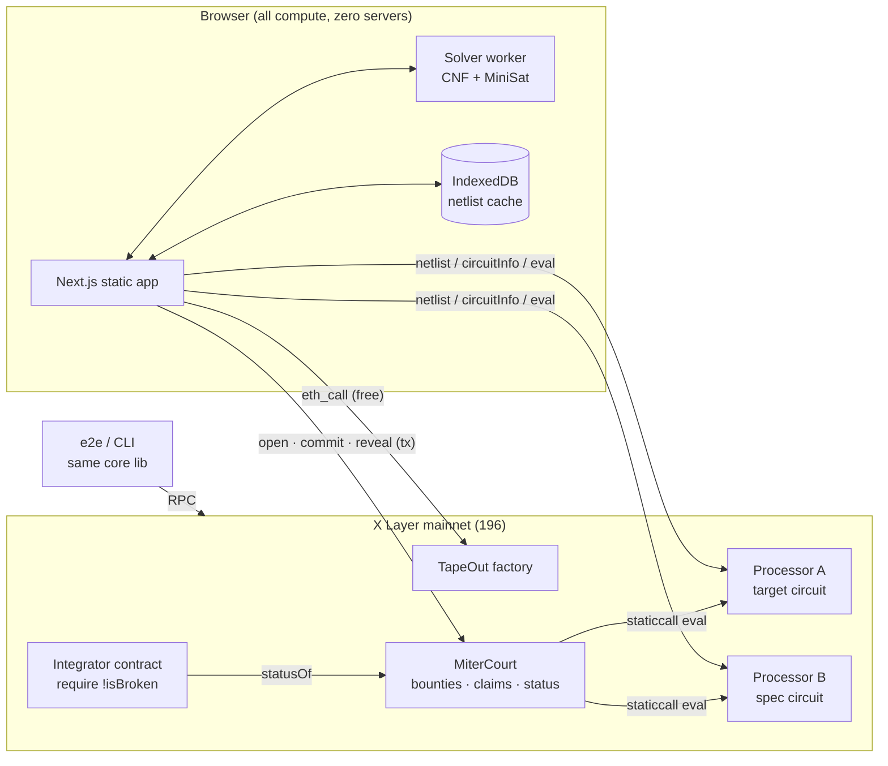
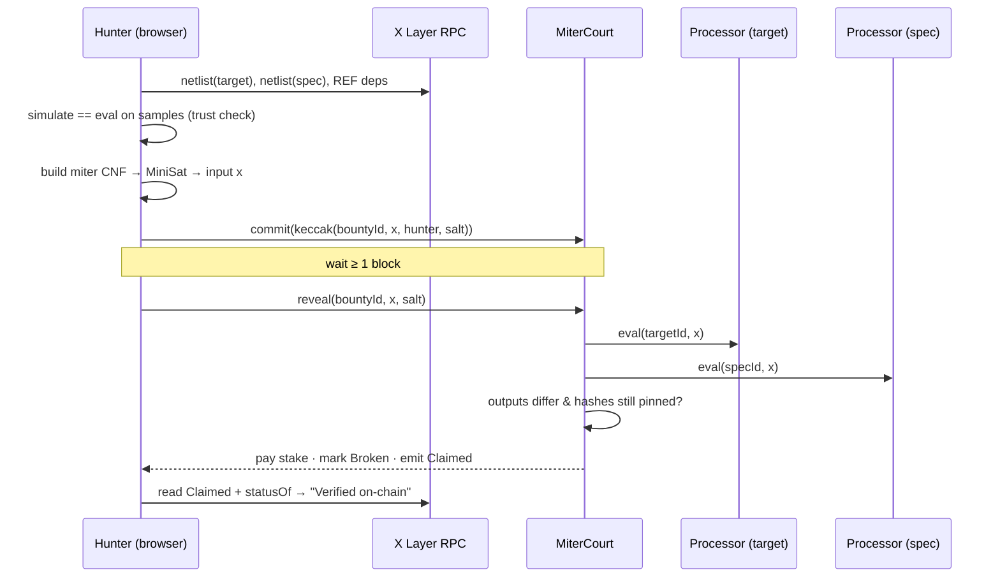

# Miter — Architecture

> **On TapeOut, a bug proves itself.**

## 1. Pitch

Miter is a correctness market for TapeOut circuits that needs no judge. Anyone can stake money behind a circuit's spec. Anyone who finds an input that breaks the spec gets paid by a contract, which re-runs the real circuit on X Layer to check the claim. The circuit is then flagged **Broken** on-chain, and any contract that depends on it can read the flag and fail closed. A SAT solver running in the user's browser hunts for breaking inputs, or shows that none exist.

**What makes it different.** Every guard circuit in the TapeOut ecosystem today (Fusebox, TapeGuard, TapeFlow, Interlock and others) is trusted on tests alone. Forgeout checks equivalence offline, but nothing puts money behind correctness, and nothing turns a bug into an on-chain fact. Miter relies on a property only TapeOut has: a circuit is finite boolean logic that anyone can evaluate for free. That makes "is this a bug?" a contract call rather than an argument. It also means the entire solution space can be searched.

A miter, in hardware verification, is the circuit built to compare two designs. It feeds both the same inputs, XORs their outputs and asks whether any input sets the result to 1. Miter does exactly that, with money attached.

## 2. Problem

| | |
|---|---|
| **Who** | Teams that use someone else's circuit as a guard, such as an agent wallet whose payments pass through Fusebox fuses, and authors who want their circuit trusted and used, since Fusebox pays the circuit owner 90% of every fuse check |
| **Workaround today** | Trust the author's README and tests. Fusebox's README says its assurance "rests on testing", and PoD samples test vectors |
| **What it costs** | Sampling 10,000 inputs of a 64-input circuit covers about 5×10⁻¹⁶ of its input space. One missed input in a spending-cap circuit can drain the guarded wallet. Off-chain bug bounties fail in a different way, through human adjudication: one researcher reported a bug exposing more than $500M at Injective and says they waited months and were then underpaid, Immunefi suspended Trust Security in a payout dispute, and CryptoSlate's "Wall of Shame" lists millions in unpaid bounties |
| **Hypothesis (unproven)** | Circuit authors will post bonds to earn integrator trust and more paid usage |

**Sponsor removal test.** Without TapeOut there is no on-chain netlist to evaluate and no finite logic to search. The contract could not check a claim and the solver would have nothing to analyse, so the core flow stops working.

## 3. Capability map

| Flow | TapeOut rail on X Layer (chain 196) |
|---|---|
| Discover circuits | Factory `0x1f09DAeFA827f02CBb40967cc91b259763760761`: `cpuCount()` and `cpuAt(i)`. There were 425 processors on 2026-11-17 |
| Load a circuit | Processor `circuitInfo(id)` and `netlist(id)`, with REF records followed recursively across processors (TAP-02) |
| Hunt (browser) | Local TAP-02 simulator, cross-checked bit for bit against processor `eval(id, inputs)` |
| Adjudicate a claim | `MiterCourt` statically calls processor `eval` on the target and the spec, then compares the outputs. Stateful circuits (M3) use `step(id, state, inputs)` |
| Pin what was bonded | Stores `keccak256(netlist(id))` when a bounty opens, because the factory is not sealed and a beacon upgrade could change a netlist. A hash mismatch voids the bounty instead of paying out |
| Owner-declared spec (M2) | Processor ERC-721 `ownerOf(id)`: only the circuit's owner can declare its canonical spec |
| Property specs (M2) | A checker circuit that REFs the target, created with `tapeout(netlist, nIn, nOut)` |
| Private disclosure (M4) | A TapeSend sealed message (TAP-10/TAP-12) to the circuit owner's container before the reveal |
| Hosting (M5, if affordable) | Mirror the static app to DeWEB `SiteRegistry` as a `tape://` site |

## 4. System overview



## 5. Components

### `packages/core`: the TypeScript core, shared by the app, CLI and e2e
- `netlist.ts`: parses and serializes the TAP-02 format (NAND `0x00`, LATCH `0x01`, REF `0x02`; u24 big-endian indices; LSB-first bit packing).
- `sim.ts`: a beat-exact simulator. NAND, a LATCH returns the previous state, REF runs recursively with its own state block.
- `chain.ts`: viem reads on X Layer, batched through Multicall where possible, plus a REF dependency loader cached by `(cpu, id, netlistHash)`.
- `cnf.ts`: Tseitin encoding of a flattened netlist, plus miter construction. Equivalence ORs the per-bit XOR of the outputs. A property is the checker's violation bit. Bounded unrolling handles LATCH circuits (M3).
- `solve.ts`: a MiniSat adapter (`logic-solver`) that runs in a Web Worker in the browser or in Node for the CLI. A satisfying model is turned back into input bytes.

### `contracts`: Foundry project
- `MiterCourt.sol`: bounties (native OKB in M1, USDT in M2), commit and reveal, adjudication through `eval`, payout, the per-circuit status registry and netlist pinning. No admin keys and no upgradeability.
- `ITapeOutProcessor.sol`: the minimal processor interface from TAP-02 §6.
- `examples/GuardedVault.sol` (M2): an integrator that refuses to use a circuit once it is Broken.
- Tests run against a fork of X Layer mainnet, so they use the real TapeOut processors with no mocks.

### `apps/web`: Next.js (App Router), static export
- `/`: open bounties, total bonded, recent claims, recently broken circuits.
- `/circuit?c=<cpu>:<id>`: circuit info, gate stats, REF dependency tree, status and bounties, a simulation console and the **Hunt** button.
- `/bounty?id=<n>`: the bounty with its claim flow, shown as named steps: *Find input → Commit → Wait one block → Reveal → Verified on-chain*.
- `/new`: open a bounty (target and spec, stake, expiry).
- Routes use query parameters because a static export cannot render dynamic paths at request time.

### `scripts`
- `e2e.ts`: drives the core flow headlessly through the same core library. It writes JSON evidence to `docs/evidence/`.

## 6. Zero-cost operation (hard constraint)

We have no paid infrastructure, so Miter is designed to need none. "Premium" comes from the product, not the hosting bill.

| Concern | Choice | Cost |
|---|---|---|
| Database | The chain. Bounties, claims and status live in `MiterCourt` storage, and history comes from events | $0 |
| Compute | SAT solving and simulation run in the user's browser in a Web Worker | $0 |
| Cache | Netlists are immutable per hash, so they are cached in browser IndexedDB, and the static assets sit on the hosting provider's CDN | $0 |
| Hosting | Static export on Cloudflare Pages free plan or Vercel Hobby. Both are free tiers, not trials | $0 |
| RPC | Public `rpc.xlayer.tech` with fallbacks, with calls batched through multicall | $0 |
| Chain writes | Measured 2026-11-17 at 0.02 gwei, with no L1 data fee: about $0.004 to deploy, about $0.012 for a heavy claim, about $0.0002 for a simple transaction | under $1 for the whole event |

## 7. On-chain data model (`MiterCourt`)

```solidity
enum Kind  { Equivalence, Property }
enum State { Open, Paid, Voided, Withdrawn }

struct Bounty {
  address funder;  uint96  amount;      // stake (native OKB in M1)
  address target;  uint64  targetId;    // circuit under test
  address spec;    uint64  specId;      // reference circuit or checker circuit
  bytes32 targetHash; bytes32 specHash; // keccak256(netlist), pinned at open
  uint32  nIn; uint32 nOut; Kind kind; State state;
  uint40  expiry; address hunter; bytes input; // input set once paid
}
mapping(bytes32 commitment => uint256 blockNumber) commits;
mapping(bytes32 circuitKey => uint256) bondedOf;   // total open stake per circuit
mapping(bytes32 circuitKey => uint256) brokenBy;   // bountyId that broke it (0 = not broken)
```

**Commitment** = `keccak256(abi.encode(bountyId, input, hunter, salt))`. The reveal must land in a later block than the commitment. Because the hunter's address is inside the hash, a copied reveal does nothing for anyone else.

**"Broken" is relative to a spec.** A bogus spec could "break" any circuit. So in M1 Broken applies only to the spec it was claimed against. In M2 the circuit's NFT owner declares a canonical spec, and `statusOf` reports against that.

## 8. Key flows

### Flow A: claim a bounty (the demo's core)



### Flow B: open a bounty
Choose a target and a spec. The app checks that pin counts match and both circuits are combinational (stateful circuits come in M3), and shows how many gates the claim would evaluate and what that costs in gas. `open()` pins both netlist hashes and escrows the stake. The funder can withdraw only after expiry, so a bond cannot be pulled the moment someone starts hunting.

### Flow C: an integrator fails closed
`GuardedVault` calls `miter.statusOf(cpu, id)` before trusting a fuse circuit and reverts if it is Broken. One line of integration.

## 9. Stack and why

| Layer | Choice | Why |
|---|---|---|
| Contracts | Solidity 0.8.x + Foundry | Fork tests against X Layer mainnet, and `cast` gives judges one-line checks |
| Chain client | viem | Typed, small, works in the browser and Node |
| SAT | `logic-solver` (MiniSat) | MIT licensed and proven. Runs in the browser and Node with no server |
| App | Next.js App Router, static export, Tailwind | Playbook default, and it hosts for free |
| Fonts | IBM Plex Sans and IBM Plex Mono | An engineering feel that suits hardware verification. Mono for every bit, hash and number |
| Monorepo | pnpm workspaces | One core library shared by app, CLI and e2e |

## 10. Out of scope

- Verifying Solidity or any logic that is not TapeOut
- BNB Chain and Base deployments (the same design would carry over)
- Deploying our own processor or factory
- On-chain verification of UNSAT proofs. "Proven" is an attestation that anyone can re-run, and it is labelled that way
- Custody beyond demo-sized stakes. The contract is unaudited and says so
- Any backend, database or paid service

## 11. Milestones

| # | Ships | Shows |
|---|---|---|
| **M1: Break a live circuit** | Core library (TAP-02 parser and simulator matching `eval` bit for bit on sampled live circuits), miter CNF with MiniSat, `MiterCourt` with Equivalence bounties and commit-reveal, fork tests, `pnpm e2e`, a web app with the explorer, bounty page and claim flow, free hosting | A live circuit is loaded from X Layer, the solver finds a breaking input in the browser, and the contract pays out after re-running the real processor |
| **M2: Specs that mean something** | Property specs (a small DSL compiled to a NAND checker that REFs the target), owner-declared canonical spec, `statusOf`, `GuardedVault`, USDT stakes, voiding on hash mismatch | An integrator fails closed on a Broken fuse |
| **M3: Memory and proofs** | LATCH circuits through bounded unrolling and `step` adjudication from the zero state. "Proven" levels: exhaustive (up to 2²⁴ inputs) and SAT UNSAT (an attestation that can be re-run) | Stateful circuit claims, and the Proven badge |
| **M4: Hunt the ecosystem** | A crawler over every processor, automatic hunts, a findings board, TapeSend sealed disclosure to circuit owners | Real findings on live ecosystem circuits |
| **M5: Ship** | A judge mode that dry-runs claims through `eth_call` without a wallet or money, UI polish, a DeWEB mirror if the fee allows, the README with true numbers, the video, the submission | The submission |

## 12. Open decisions

- **Property checker circuits.** We can tape them out (about $0.11 each plus transistor tokens, which adds to the ecosystem) or evaluate them with an interpreter inside our contract (free, but less native). We will decide in M2 once transistor token prices on X Layer are known.
- **DeWEB mirror.** This depends on `DomainBinding.monthlyFee()` on X Layer.
